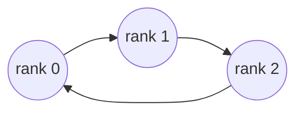

# disty: ring all-reduce from scratch

[](https://github.com/Saurav727/disty/actions/workflows/ci.yml)

Distributed gradient averaging for PyTorch, written in plain Python with nothing
but sockets and `array('d')`. No `torch.distributed`, no NCCL, no MPI.

Disty is a ring all-reduce, the communication step behind data-parallel training,
built so that every part of it can be read, traced and measured. It was built for
**heterogeneous consumer hardware** (ordinary PCs on ordinary Ethernet), the
setting where data-centre tools such as NCCL are a poor fit.

> Course project (ENCT 386, Networking). Team: `<names>` · My part: `<what you built>`

## Why a ring

The simple approach is to send every gradient to one node, add them up, and send
the answer back. That master has to receive N gradients and send N back, so it
gets slower as you add nodes, the opposite of the point.

In a ring every node talks only to its two neighbours and moves the same amount:

    2 × (N−1)/N × gradient_size

`(N−1)/N` never reaches 1, so no node moves more than twice its gradient, whether
there are 3 nodes or 1000, and no link is busier than any other.



## Quick start

`run.py` and `launch_local.py` need only Python 3. Training needs PyTorch.

```bash
pip install torch                              # only for training and tracing

python launch_local.py --nodes 3               # correctness tests, 3 real processes
python launch_local.py --nodes 3 --script train_ring.py   # train a real PyTorch model
python launch_local.py --nodes 3 --script trace_ring.py   # watch every number move
```

Any node count works. The same commands work on Windows, Linux and macOS. Each
node is a separate process with real sockets, so only the network is simulated.

## Results

Fill these in from your own runs (hardware, then numbers):

| | |
|---|---|
| Machines | `<CPU / RAM / OS of each>` |
| Link | `<e.g. Gigabit Ethernet, ~905 Mbps measured with iperf>` |

| Test | Result |
|---|---|
| Correctness suite | passes at 2, 3, 4, 5, 6, 7, 8 and 11 nodes |
| Gradient vs single-machine whole-batch gradient | worst difference `<value>` |
| 45 MB, 3 nodes | `<time>`, 60 MB each way (matches `2×(N−1)/N`) |

`<chart: time per all-reduce vs node count, and step time vs communication time>`

## How it works

Every node computes a gradient from its own slice of the data, so every node has a
*different* gradient. Training wants the average. The flat gradient is cut into N
equal chunks, one per node, and passed round the ring twice:

1. **Lap 1, reduce-scatter** (N−1 steps): pass a chunk on and *add* the chunk that
   arrives. After N−1 steps each node holds one finished chunk, a different one each.
2. **Lap 2, all-gather** (N−1 steps): pass the finished chunks round, *overwriting*
   instead of adding, until everyone has all N.
3. **Divide** by N.

`trace_ring.py` runs this on a six-number gradient and prints every value at every
step. Read it first.

## Using it with PyTorch

No autograd hooks and no model wrapper. PyTorch leaves a gradient in `p.grad`, we
replace it with the averaged one, PyTorch steps:

```python
optimiser.zero_grad()                                     # stock
loss = torch.nn.functional.mse_loss(model(x), y)          # stock
loss.backward()                                           # stock

mine = gather_gradients(model)                                    # inserted
averaged = allreduce.all_reduce(mine, rank, world_size, link)     # inserted
scatter_gradients(model, averaged)                                # inserted

optimiser.step()                                          # stock
```

## Design decisions

- **Padding instead of length headers.** If the gradient doesn't divide by N, it is
  padded with at most N−1 zeros and trimmed afterwards. Every chunk is then the same
  size, so the block you send always matches the block you receive.
- **Sending happens on a thread.** `sendall()` blocks until the other side reads. If
  every node sent first and read second, the ring would deadlock. Sending on a thread
  lets each node send and receive at once (see `ring.py`).
- **Slicing.** Big gradients are reduced in 2 MB slices so blocks stay close to the OS
  socket buffer size, rather than handing one 45 MB write to the socket.
- **`TCP_NODELAY`** is set on TCP links so small blocks aren't held back by Nagle.
- **Local sockets where available.** On Linux/macOS, `launch_local.py` uses Unix
  sockets. On WSL2, 127.0.0.1 is routed through Windows and can drop packets under
  load, so this matters there. Windows falls back to 127.0.0.1.
- **Polite shutdown.** `Link.close()` half-closes and drains, so a slow neighbour never
  sees a connection vanish mid-block.

## Running on real machines

Give every device the **same** `--peers` list and change only `--rank` (position in
the list is the rank):

```bash
# on 10.0.0.1
python run.py --rank 0 --peers 10.0.0.1:29600,10.0.0.2:29600
# on 10.0.0.2
python run.py --rank 1 --peers 10.0.0.1:29600,10.0.0.2:29600
```

- Allow inbound TCP on the port (29600 by default) in each machine's firewall.
- Under WSL2, run the node natively on Windows instead if binding fails.

## Known limitations

- **Speed is bounded by Python, not the network.** The add and average steps are
  per-element Python loops, so throughput is far below link speed. A NumPy path for
  those two loops is the obvious next step.
- **float64 only.** Fine for verifying correctness, but real training uses float32/fp16.
- **Cross-platform gradient mismatch.** With one Windows and one Linux node, the ring
  gradient differs from the single-machine reference by about 3e-10 (two Windows
  nodes pass cleanly). Under investigation: `<findings>`.
- No straggler handling: the ring runs at the speed of its slowest node.
- No fault tolerance: if a node dies, the ring stops.

## Roadmap

- [ ] NumPy fast path for the reduce and average loops
- [ ] float32 / fp16 gradient transport
- [ ] Overlap communication with the backward pass using `register_hook`
- [ ] Gradient accumulation to improve the compute-to-communication ratio
- [ ] Straggler-aware behaviour for heterogeneous nodes

## Files

| file | what it does |
|---|---|
| `ring.py` | Networking only: connects the ring, swaps byte blocks with the two neighbours. |
| `allreduce.py` | The algorithm only: reduce-scatter, then all-gather. Never touches a socket. |
| `train_ring.py` | A real PyTorch model trained across the ring. |
| `trace_ring.py` | The same with a six-number gradient, printing every step. |
| `run.py` | Correctness tests, ending with a 45 MB transfer. |
| `launch_local.py` | Starts N processes on one machine so you can try it without N machines. |
